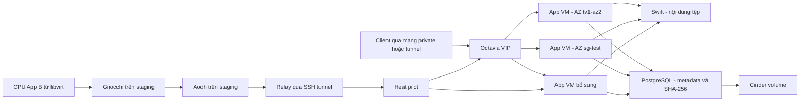

# File Integrity System — Nhóm 14

## Giới thiệu dự án

File Integrity System là ứng dụng bài tập lớn môn Điện toán đám mây, phục vụ lưu trữ tệp và kiểm tra tính toàn vẹn bằng SHA-256 trên OpenStack.

Người dùng thao tác qua giao diện web hoặc REST API để upload, xem danh sách, tải xuống và xác minh tệp. Hệ thống lưu nội dung trong storage và lưu metadata gồm UUID, tên tệp, dung lượng, SHA-256, thời điểm tạo trong PostgreSQL.

- Backend: Python, FastAPI, SQLAlchemy.
- Frontend: HTML, CSS và JavaScript; không cần bước build.
- Dữ liệu: PostgreSQL 16, Swift Object Storage và Cinder Block Storage.
- Triển khai: Docker Compose, OpenStack, Octavia và Heat.
- Giám sát và co giãn: metric CPU, Gnocchi và Aodh.
- Kiểm thử: pytest, Node.js test runner và Locust.

Giới hạn upload mặc định là 25 MiB/tệp. Tệp rỗng được chấp nhận; các tệp trùng tên có UUID riêng. API key dùng chung có thể bật để bảo vệ các API tệp.

## Cấu trúc mã nguồn

```text
app/
  main.py                 Khởi tạo ứng dụng FastAPI
  config.py               Đọc và kiểm tra biến môi trường
  database.py             Kết nối và session database
  models.py               Schema metadata tệp
  routes/                 API tệp và health check
  services/               Xử lý upload, download và verify
  storage/                Interface storage, adapter local và Swift
frontend/                 Giao diện web
deploy/
  compose.openstack.yaml  Cấu hình container trên App VM
  app.env.example         Biến môi trường mẫu cho OpenStack
  elasticity/             Template Heat, Octavia, autoscaling và công cụ kiểm tra
  infrastructure/         Script mạng, firewall và systemd unit theo lab
  tv2/                    Hướng dẫn truy cập và vận hành lab dữ liệu
loadtest/                 Workload Locust và kiểm tra dữ liệu
scripts/                  Khởi động, dừng, kiểm thử và kết nối lab
tests/                    Kiểm thử API, storage, frontend và công cụ triển khai
docs/                     API contract và tài liệu kỹ thuật
.github/workflows/        GitHub Actions CI
Dockerfile                Đóng gói ứng dụng
compose.yaml              App và PostgreSQL cho môi trường local
compose.dev.yaml          Bind mount và reload khi phát triển
.env.example              Biến môi trường mẫu cho local
requirements.txt          Dependency trực tiếp
requirements.lock.txt     Phiên bản dependency dùng khi build Docker
```

## Kiến trúc hệ thống

### Môi trường local

Docker Compose chạy hai dịch vụ: FastAPI phục vụ cả API và giao diện web, PostgreSQL lưu metadata. Nội dung tệp dùng adapter local và được lưu trên Docker volume.

Hai named volume `postgres-data` và `file-data` lưu database và nội dung tệp độc lập với vòng đời container.

### Môi trường OpenStack



Octavia phân phối request tới các App VM. Các instance dùng chung PostgreSQL và container Swift, cho phép tệp được upload qua một backend và đọc lại qua backend khác. PostgreSQL đặt thư mục dữ liệu trên Cinder volume.

Luồng co giãn dùng metric CPU trong Gnocchi, alarm Aodh và policy Heat. Phương án pilot sử dụng relay qua SSH tunnel để chuyển callback từ staging tới Heat; backend bổ sung được đăng ký vào pool Octavia theo vòng đời tài nguyên.

### Luồng xử lý tệp

1. **Upload:** nhận raw bytes, kiểm tra giới hạn dung lượng, tính SHA-256, ghi nội dung vào storage và lưu metadata trong PostgreSQL.
2. **Danh sách:** đọc metadata theo trang để hiển thị tên, kích thước và hash.
3. **Download:** lấy object theo UUID và trả nội dung dưới dạng attachment.
4. **Verify:** đọc lại object, tính SHA-256 và dung lượng, rồi đối chiếu với metadata. Nội dung thay đổi trả `intact=false`; lỗi dependency được trả riêng.

## Cách thực hiện

### 1. Chạy ứng dụng local

Cài Docker Engine và Docker Compose. Trên Windows, dùng Docker Desktop với Linux containers. Mở PowerShell tại thư mục gốc repository:

```powershell
if (-not (Test-Path .env)) { Copy-Item .env.example .env }
docker compose up --build -d --wait --wait-timeout 180
```

Hoặc chạy `./scripts/start.ps1`.

- Giao diện: http://localhost:8000
- API docs: http://localhost:8000/docs
- Readiness: http://localhost:8000/health/ready

Chọn tệp để upload, bấm Verify để kiểm tra toàn vẹn và Download để tải lại. Nếu cổng 8000 đang được sử dụng, đổi `APP_PORT` trong `.env`.

```powershell
docker compose ps
docker compose logs --tail 100 app
docker compose stop
docker compose up -d --wait
```

Dừng hoặc tạo lại container vẫn giữ dữ liệu trên volume. Lệnh `docker compose down -v` sẽ xóa các volume.

Khi phát triển với bind mount và reload:

```powershell
docker compose -f compose.yaml -f compose.dev.yaml up --build -d --wait
```

### 2. Cấu hình môi trường

| Tệp cấu hình | Mục đích |
|---|---|
| `.env.example` | Mẫu cho local: mật khẩu PostgreSQL, cổng app, storage, API key và giới hạn upload |
| `compose.yaml`, `compose.dev.yaml` | Service, network, volume, health check và chế độ phát triển |
| `deploy/app.env.example` | Mẫu kết nối PostgreSQL, Keystone và Swift trên OpenStack |
| `deploy/compose.openstack.yaml` | Chạy container ứng dụng trên App VM private |
| `deploy/tv2/lab-access.example.json` | Mẫu kết nối SSH tunnel tới lab |
| `deploy/elasticity/` | Template và tham số image, flavor, mạng, AZ, pool, policy, ngưỡng CPU và cooldown |
| `deploy/infrastructure/` | Script mạng, firewall và cấu hình dịch vụ theo topology lab |

Tạo file cấu hình riêng từ mẫu và điền giá trị của môi trường triển khai. Khi bật `APP_API_KEY`, nhập key trên giao diện hoặc gửi header `X-API-Key`. Giữ mật khẩu, token, private key, `.env` và `app.env` thật ngoài Git.

### 3. Triển khai trên OpenStack

Chuẩn bị các App VM, PostgreSQL trên Cinder, container Swift và Keystone application credential. Bảo đảm App VM kết nối được database, Keystone, Swift; Octavia truy cập được cổng 8000 của backend.

Chuyển mã nguồn tới từng App VM. Trong thư mục `deploy/`, tạo và điền cấu hình:

```sh
test -f app.env || cp app.env.example app.env
chmod 600 app.env
docker compose --env-file app.env -f compose.openstack.yaml up -d --build --wait
```

Mọi App VM phải dùng cùng database và container Swift. Cấu hình security group và đường truy cập qua VIP phù hợp với mạng của lab.

Chọn phương án Heat/Octavia theo topology:

- `baseline-lb.json`: tạo LB cho hai App VM có sẵn.
- `autoscale.json` và `app-member.json`: tạo LB riêng và các nhóm VM theo AZ.
- `octavia-pilot*.yaml`: thêm backend vào pool hiện có.
- `templates/*.yaml`: phương án YAML với bộ tham số riêng.

Mỗi phương án có environment và tài nguyên quản lý riêng. Kiểm tra image, network/subnet, AZ, quota, metric và callback trước khi bật alarm.

Hướng dẫn chi tiết: [triển khai OpenStack](deploy/README.md), [Heat/Octavia/autoscaling](deploy/elasticity/README.md) và [truy cập lab TV2](deploy/tv2/README.md).

### 4. Sử dụng API

| Phương thức | Đường dẫn | Chức năng |
|---|---|---|
| GET | `/health/live` | Kiểm tra tiến trình API |
| GET | `/health/ready` | Kiểm tra database và storage |
| POST | `/api/files?filename=example.txt` | Upload raw bytes |
| GET | `/api/files?offset=0&limit=50` | Danh sách phân trang |
| GET | `/api/files/{id}/download` | Tải nội dung |
| POST | `/api/files/{id}/verify` | Đối chiếu SHA-256 và dung lượng |

Upload dùng body nhị phân trực tiếp, không dùng multipart. Chi tiết request, response và mã lỗi: [API contract](docs/API_CONTRACT.md).

### 5. Kiểm thử và tạo tải

Sau khi stack Docker sẵn sàng, chạy bộ kiểm thử bằng PowerShell; Node.js 20+ cần cho test frontend:

```powershell
./scripts/test.ps1
```

Chạy riêng frontend và kiểm tra template JSON:

```powershell
node --test tests/frontend/api-client.test.cjs tests/frontend/app.test.cjs
python deploy/elasticity/kit.py lint
```

Bộ YAML dùng dependency riêng; chạy trong virtual environment:

```powershell
python -m pip install -r deploy/elasticity/requirements-check.txt
python deploy/elasticity/validate.py
python -m unittest discover -s deploy/elasticity/tests -v
```

Workload Locust tái sử dụng tệp fixture, đối chiếu hash/dung lượng khi download và kiểm tra nội dung verify. Cách chọn fixture, chạy profile và xuất báo cáo nằm trong [hướng dẫn tạo tải](loadtest/README.md).
