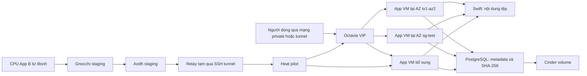

# File Integrity System — Nhóm 14

Bài tập lớn môn Điện toán đám mây: lưu trữ tệp và kiểm tra tính toàn vẹn bằng SHA-256 trên OpenStack.

Bản mã nguồn chốt ngày **22/11/2026**, sử dụng nhánh `main`. Repository gồm ứng dụng, cấu hình mẫu, kiểm thử và minh chứng kỹ thuật. Kết quả triển khai được ghi theo từng phiên nghiệm thu; chúng không xác nhận lab đang bật ở thời điểm đọc.

## Chức năng

- Upload, liệt kê có phân trang, tải xuống và kiểm tra lại tệp.
- PostgreSQL lưu UUID, tên tệp, dung lượng, SHA-256 và thời điểm tạo.
- Verify đọc lại nội dung từ storage và đối chiếu hash cùng dung lượng. Nội dung thay đổi trả `intact=false`, kể cả khi HTTP là 200.
- Giao diện có tiến trình/hủy upload, sao chép hash và kết quả xác minh chi tiết.
- Hỗ trợ storage local khi chạy Docker và Swift trên OpenStack.
- Giới hạn mặc định 25 MiB/tệp; chấp nhận tệp rỗng; tên trùng có UUID riêng.
- API key dùng chung tùy chọn cho các API tệp.

## Kiến trúc



Các App VM dùng chung PostgreSQL và container Swift. Cinder lưu dữ liệu PostgreSQL; Swift lưu nội dung tệp. Hai AZ trong sơ đồ là AZ của Nova, không đồng nghĩa toàn bộ hệ thống có dự phòng ở hai vùng AWS.

Bản local chạy FastAPI và PostgreSQL 16 bằng Compose, dùng Docker volume để lưu nội dung thay cho Swift.

## Kết quả đã đạt được

| Hạng mục | Kết quả có minh chứng |
|---|---|
| Ứng dụng và dữ liệu | Upload/list/download/verify; đọc Swift object và đối chiếu metadata PostgreSQL, SHA-256, dung lượng |
| Lưu trữ bền vững | PostgreSQL dùng Cinder volume 10 GiB tại `/srv/postgresql`; lab TV2 có kiểm tra persistence và backup/restore |
| Hai AZ và cân bằng tải | Hai backend gốc ở `tv1-az2` và `sg-test`; Octavia phục vụ qua VIP; đã thử rút lần lượt backend và đọc dữ liệu chung |
| Co giãn tự động | Ngày 13/11: CPU → Gnocchi → Aodh → Heat → Octavia; số member ONLINE **2 → 3 → 2** |
| Toàn vẹn sau co giãn | Download và verify qua VIP sau scale-out và scale-in đều khớp SHA-256 |
| Khả dụng trong lượt 13/11 | **56/60 HTTP 200**, 4 timeout ở ngưỡng 4 giây; p95 **2,42 giây** trên phản hồi thành công |
| Rà soát dữ liệu 19/11 | Tệp mẫu 94 byte khớp giữa Swift, PostgreSQL, download và verify qua App A; đối chiếu với log VIP lịch sử |
| Kiểm soát truy cập | API key; kiểm thử scope Keystone và security group trong lab TV2 |

Nguồn: [nghiệm thu autoscaling 13/11](docs/evidence/autoscaling-acceptance-20261113.md), [minh chứng dữ liệu 19/11](docs/TV2_FINAL_EVIDENCE.md), [kiểm thử TV2](deploy/tv2/evidence/README.md), [telemetry staging](docs/evidence/telemetry-staging-retest-20261112.md), [kiểm thử local](docs/VERIFICATION.md).

Lượt autoscaling dùng tải CPU tổng hợp có giới hạn, telemetry trên staging và relay tạm; chưa chạy Locust xuyên suốt chu kỳ. Pilot, alarm và relay đã được dọn sau nghiệm thu. Bộ dò HTTP kết thúc trước khi scale-in hoàn tất; download/verify sau scale-in là phép kiểm tra riêng.

## Chạy thử bằng Docker

Yêu cầu Docker Engine và Docker Compose; trên Windows dùng Docker Desktop với Linux containers. Mở PowerShell tại thư mục gốc repository:

```powershell
if (-not (Test-Path .env)) { Copy-Item .env.example .env }
docker compose up --build -d --wait --wait-timeout 180
```

- Giao diện: http://localhost:8000
- API docs: http://localhost:8000/docs
- Readiness: http://localhost:8000/health/ready

Có thể dùng `./scripts/start.ps1` để khởi động. Nếu cổng 8000 đang dùng, đổi `APP_PORT` trong `.env`. Upload một tệp, bấm Verify, tải xuống và đối chiếu SHA-256 với tệp gốc.

```powershell
docker compose ps
docker compose logs --tail 100 app
docker compose stop
docker compose up -d --wait
```

Hai volume `postgres-data` và `file-data` giữ dữ liệu qua các lần tạo lại container. Lệnh `docker compose down -v` xóa các volume này.

## API chính

| Phương thức | Đường dẫn | Chức năng |
|---|---|---|
| GET | `/health/live` | Kiểm tra tiến trình API |
| GET | `/health/ready` | Kiểm tra database và storage |
| POST | `/api/files?filename=example.txt` | Upload body là byte tệp trực tiếp |
| GET | `/api/files?offset=0&limit=50` | Danh sách, tối đa 200 mục/lần |
| GET | `/api/files/{id}/download` | Tải nội dung |
| POST | `/api/files/{id}/verify` | Tính lại SHA-256 và dung lượng |

Upload dùng raw bytes, không dùng multipart. Khi bật `APP_API_KEY`, các đường dẫn `/api/*` cần header `X-API-Key`. Chi tiết: [API contract](docs/API_CONTRACT.md).

## Cấu hình cần nộp là gì?

**Cấu hình là các tệp và tham số mô tả cách dựng, kết nối và vận hành hệ thống từ mã nguồn.** Phần này gồm cấu hình container, biến môi trường, storage, mạng, cân bằng tải và autoscaling, bên cạnh thông số CPU/RAM.

| Nhóm | Tệp/thư mục cần nộp | Nội dung |
|---|---|---|
| Đóng gói | `Dockerfile`, `requirements.txt`, `requirements.lock.txt` | Runtime, dependency và lệnh khởi động |
| Chạy local | `compose.yaml`, `compose.dev.yaml`, `.env.example` | App, PostgreSQL, cổng, volume, health check, giới hạn tệp |
| App OpenStack | `deploy/compose.openstack.yaml`, `deploy/app.env.example` | Kết nối PostgreSQL, Swift, Keystone và API key |
| Truy cập lab | `deploy/tv2/lab-access.example.json` | Mẫu SSH tunnel tới App VM private |
| Heat/Octavia/autoscaling | `deploy/elasticity/` | Image/flavor, mạng/subnet, AZ, security group, pool, policy, ngưỡng CPU, cooldown |
| Mạng và dịch vụ | `deploy/infrastructure/`, tài liệu hạ tầng trong `docs/` | Script mạng/firewall, systemd unit, thông số và điều kiện vận hành lab |
| Tạo tải và kiểm tra | `loadtest/`, `scripts/`, `.github/workflows/ci.yaml` | Workload, kiểm thử, thu kết quả và CI |

Nộp **tệp mẫu và hướng dẫn điền tham số**. Endpoint, UUID tài nguyên, image/flavor và AZ phải lấy đúng từ môi trường triển khai. **Không nộp mật khẩu, token, application secret, SSH private key, `.env` hoặc `app.env` thật.**

Bộ JSON tạo LB và nhóm VM riêng; bộ YAML cũ có topology riêng; pilot `octavia-pilot*.yaml` bổ sung backend vào pool hiện có. Không triển khai chồng các bộ lên cùng tài nguyên. Tham số mặc định trong mẫu không đại diện cho mọi phiên nghiệm thu: lượt 13/11 dùng hai cửa sổ 60 giây, ngưỡng tăng 70% và giảm 25%.

Hướng dẫn: [triển khai OpenStack](deploy/README.md), [Heat/Octavia/autoscaling](deploy/elasticity/README.md), [vận hành TV2](deploy/tv2/README.md). Repo cung cấp cấu hình ứng dụng và công cụ triển khai theo lab; chưa phải bộ tự động dựng lại toàn bộ DevStack.

## Kiểm thử

Node.js 20+ chỉ cần cho test frontend. Sau khi stack Docker sẵn sàng:

```powershell
./scripts/test.ps1
```

Script chạy frontend, pytest, JSON lint, API smoke và workload Locust. Smoke API tạo một tệp giả có tiền tố `smoke-`. Chạy riêng các kiểm tra offline:

```powershell
node --test tests/frontend/api-client.test.cjs tests/frontend/app.test.cjs
python deploy/elasticity/kit.py lint
```

Bộ YAML dùng dependency riêng, nên cài trong virtual environment:

```powershell
python -m pip install -r deploy/elasticity/requirements-check.txt
python deploy/elasticity/validate.py
python -m unittest discover -s deploy/elasticity/tests -v
```

Locust tái sử dụng fixture và kiểm tra cả hash/dung lượng cùng nội dung verify. Xem [hướng dẫn tạo tải](loadtest/README.md). Kiểm thử local/offline không thay thế minh chứng OpenStack.

Kiểm tra bản chốt ngày 22/11/2026: **68 ca đạt** (17 frontend, 22 công cụ JSON/HTTP, 14 công cụ YAML, 15 validation/runner tải); JSON lint và validator của 4 template YAML đạt. Máy chốt mã không có Docker, nên chưa chạy lại bộ pytest ứng dụng và smoke PostgreSQL bằng Compose trong phiên này.

## Phạm vi repository và gói nộp

GitHub chỉ lưu mã nguồn, cấu hình mẫu, kiểm thử, script vận hành và tài liệu kỹ thuật liên quan đến hệ thống. Các minh chứng kiểm thử đi kèm nằm trong `docs/evidence/` và `deploy/tv2/evidence/`.

Theo yêu cầu bài tập lớn, bản đề xuất, báo cáo cuối và video demo được nộp riêng ngoài repository. Các định dạng tài liệu và bản ghi này đã được thêm vào `.gitignore`.

## Giới hạn

- API key là khóa dùng chung; chưa có tài khoản và phân quyền riêng cho từng người.
- Swift lab TV2 có một replica; Swift/Cinder dùng chung EBS của EC2 TV2. Hai AZ ở tầng App chưa cung cấp HA cho toàn bộ tầng dữ liệu.
- Chưa có API xóa tệp, chữ ký số, lưu trữ bất biến hay schema migration tự động.
- Hash gốc nằm trong PostgreSQL; nếu cả nội dung và metadata cùng bị sửa thì phép đối chiếu hiện tại không phát hiện được.
- Phiên 19/11 xác minh qua App A và log VIP lịch sử; chưa bổ sung log upload/list mới qua VIP cho cùng tệp mẫu.
- App B từng có floating IP quản trị; cần đối chiếu cấu hình thực tế khi đánh giá yêu cầu App private.
- Phải bật lại lab và kiểm tra endpoint/VPN/readiness trước demo live. Telemetry staging và relay của lần nghiệm thu cần được chuẩn bị lại nếu muốn chạy autoscaling live.
