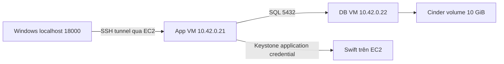

# Chạy và kiểm thử phần TV2 trên OpenStack

Phần backend và dữ liệu đã được triển khai thật trên EC2 (public IP tại ngày 28/10/2026: `18.140.98.121`). Ứng dụng chạy trong VM Nova private, lưu nội dung qua Swift và metadata trong PostgreSQL có thư mục dữ liệu đặt trên volume Cinder. Đây là môi trường độc lập của TV2 trên một compute; nhóm vẫn cần tích hợp hai AZ, Octavia và autoscaling.

Phiên triển khai đã đạt 17 kiểm thử của project và 28 kiểm tra tích hợp thật, gồm kiểm tra lỗi dependency, scope Keystone, backup/restore. Reboot riêng DB VM và App VM đều giữ được dữ liệu. Ngày 27/10/2026 đã kiểm chứng thêm sau khi Stop/Start EC2: dịch vụ nền tự chạy, bật lại hai VM bằng `btl-tv2 start`, web sẵn sàng và SHA-256 của tệp cũ vẫn khớp.

Ngày 28/10/2026 đã chạy lại: **17 pytest đạt**, smoke API/frontend đạt và **22 kiểm tra tích hợp thật đạt**. Phiên này không dừng database hoặc reboot VM; 6 ca lỗi DB/backup bổ sung và bằng chứng reboot thuộc phiên trước. Xem [đối chiếu yêu cầu TV2 và bằng chứng đã lưu](evidence/README.md).

## Mô hình đã dựng



| Thành phần | Cấu hình |
|---|---|
| Project | `btl-tv2` |
| Mạng | `btl-private`, `10.42.0.0/24`, MTU 1400 |
| App VM | `btl-app`, 1 vCPU, RAM 1 GiB, root disk 8 GiB |
| Database VM | `btl-db`, 1 vCPU, RAM 1 GiB, root disk 8 GiB |
| Cinder | `btl-postgres-data`, 10 GiB, mount `/srv/postgresql` trong DB VM |
| PostgreSQL | Phiên bản 16, database/user `integrity`, data directory `/srv/postgresql/data` |
| Swift | Container `file-integrity`, một replica trên một thiết bị lab, quota container 1 GiB |
| App VM và DB VM | Không có floating IP |
| Mã nguồn trên App VM | `/srv/file-integrity` |
| Công cụ vận hành trên EC2 | `btl-tv2`, mã hỗ trợ trong `/srv/btl-tv2` |

Swift và Cinder đang dùng chung ổ EBS vật lý của EC2. Hai dịch vụ và cách truy cập khác nhau đã được kiểm chứng, nhưng mô hình này chưa có dự phòng khi EC2 hỏng. MySQL trên EC2 là database điều khiển OpenStack; PostgreSQL trong DB VM là database của ứng dụng.

## 1 Mở giao diện từ Windows

Mở PowerShell:

```powershell
& 'D:\aws\btl-tv2-20261026\Open-App.ps1'
```

Script tạo SSH tunnel ở nền bằng key `D:\aws\openstack-lab-key-2.pem`. Sau đó mở:

- Giao diện: http://127.0.0.1:18000
- API docs: http://127.0.0.1:18000/docs
- Readiness: http://127.0.0.1:18000/health/ready

API key được lưu riêng tại `D:\aws\btl-tv2-20261026\access.json`. Mở file đó, sao chép giá trị `api_key` vào ô API key trên giao diện, rồi tải lại danh sách. File không nằm trong repository và không được đưa lên Git hoặc gửi kèm báo cáo.

Cách tạo tunnel thủ công, giữ cửa sổ PowerShell này mở:

```powershell
ssh -i 'D:\aws\openstack-lab-key-2.pem' -N -L 127.0.0.1:18000:10.42.0.21:8000 ubuntu@18.140.98.121
```

Nếu EC2 được stop/start và đổi public IP, truyền IP mới vào `Open-App.ps1 -Ec2Host IP_MOI`. Địa chỉ private của hai VM vẫn là địa chỉ trong mạng OpenStack, không phải địa chỉ để truy cập trực tiếp từ Windows.

## 2 Kiểm tra tự động từng nhóm

SSH vào EC2:

```powershell
ssh -i 'D:\aws\openstack-lab-key-2.pem' ubuntu@18.140.98.121
```

Tại shell EC2:

```bash
btl-tv2 status
btl-tv2 check
```

`status` hiện tài nguyên, dịch vụ lỗi nếu có, địa chỉ và readiness. `check` chạy kiểm thử API, Swift, PostgreSQL và quyền truy cập. Nó tạo các tệp demo nhỏ có tiền tố `tv2-`; tệp thử bị sửa hoặc xóa sẽ được phục hồi trong bước kiểm tra.

Trong phiên lab riêng, chạy toàn bộ kiểm tra lỗi và backup:

```bash
btl-tv2 test-all
```

Lệnh này tạm dừng PostgreSQL để thử lỗi rồi khởi động lại, tạo bản backup và restore vào database tạm riêng. Không chạy khi thành viên khác đang demo. Kết quả mong đợi là `PASS 28 checks`; database tạm được xóa sau khi kiểm tra.

Để thử độ bền dữ liệu qua reboot của hai VM:

```bash
btl-tv2 reboot-test
```

Lệnh reboot lần lượt DB VM và App VM, kiểm tra Cinder tự mount, PostgreSQL/Docker khởi động và SHA-256 của tệp fixture vẫn đúng. Nó không reboot EC2 hoặc xóa volume. Thường cần vài phút.

Kết quả gần nhất trên EC2 nằm tại:

```text
/srv/btl-tv2/evidence/tv2-verification.json
/srv/btl-tv2/evidence/persistence.json
```

`tv2-verification.json` trên EC2 bị ghi đè sau mỗi lần chạy `check` hoặc `test-all`. Bản 28 ca ngày 26/10 và bản 22 ca ngày 28/10 được lưu riêng trong [evidence/](evidence/README.md) để phân biệt lịch sử.

Script kiểm tra được bàn giao tại [verify_tv2.py](verify_tv2.py), chạy bằng Python hệ thống trên EC2 với `requests`, `keystoneauth1`, `python-swiftclient`. Nó dùng cấu hình lab `/srv/btl-tv2/state.json`, credential riêng `/srv/btl-tv2/secrets.json` và SSH key `/srv/btl-tv2/id_ed25519` cùng `known_hosts` để vào DB VM. Những file riêng này phải được cấp ngoài Git; script không phải bộ dựng lab mới và không chạy độc lập trên máy vừa clone. `btl-tv2` và `Open-App.ps1` là tiện ích đã cài trong môi trường lab; máy khác có thể dùng lệnh SSH thủ công bên trên.

## 3 Kiểm tra bằng giao diện

| Thao tác | Kết quả mong đợi |
|---|---|
| Mở trang | Trạng thái `Sẵn sàng · swift` |
| Nhập API key, chọn tệp và upload | Xuất hiện bản ghi có ID, dung lượng, SHA-256 |
| Bấm Verify | Hiển thị toàn vẹn; hash gốc và hash tính lại trùng nhau |
| Bấm Download | Nội dung và SHA-256 giống tệp ban đầu |
| Upload hai tệp cùng tên | Có hai ID khác nhau, không ghi đè |
| Upload tệp rỗng | Được chấp nhận, dung lượng 0 byte, Verify thành công |
| Bỏ API key hoặc nhập sai | API danh sách/upload/download/verify bị từ chối |
| Upload lớn hơn 25 MiB | Bị từ chối với HTTP 413 |

Readiness được mở không cần API key để phục vụ health check. API key hiện là khóa dùng chung của nhóm; ứng dụng chưa có tài khoản hay phân quyền riêng cho từng người dùng.

## 4 Kiểm tra API từ PowerShell

Đảm bảo tunnel đang chạy. Khởi tạo biến mà không in secret:

```powershell
$Base = 'http://127.0.0.1:18000'
$Access = Get-Content -Raw -LiteralPath 'D:\aws\btl-tv2-20261026\access.json' | ConvertFrom-Json
$Headers = @{ 'X-API-Key' = $Access.api_key }
Invoke-RestMethod "$Base/health/ready"
```

Upload, tải xuống và đối chiếu hash:

```powershell
$Tag = [guid]::NewGuid().ToString('N').Substring(0,8)
$InputFile = Join-Path $env:TEMP "tv2-$Tag.txt"
$OutputFile = Join-Path $env:TEMP "tv2-$Tag-downloaded.txt"
[IO.File]::WriteAllText($InputFile, 'Kiem thu TV2 tren Swift va Cinder')

$Record = Invoke-RestMethod -Method Post -Uri "$Base/api/files?filename=tv2-$Tag.txt" -Headers $Headers -ContentType 'application/octet-stream' -InFile $InputFile
$Record
Invoke-RestMethod -Uri "$Base/api/files" -Headers $Headers
Invoke-WebRequest -Uri "$Base/api/files/$($Record.id)/download" -Headers $Headers -OutFile $OutputFile
Get-FileHash -Algorithm SHA256 -LiteralPath $InputFile,$OutputFile
Invoke-RestMethod -Method Post -Uri "$Base/api/files/$($Record.id)/verify" -Headers $Headers
```

Kết quả: HTTP upload 201, hai hash giống nhau, `intact=true`, `expected_size=actual_size`. Upload dùng raw bytes; không dùng multipart/FormData.

Kiểm tra thiếu API key:

```powershell
curl.exe -s -o NUL -w '%{http_code}' 'http://127.0.0.1:18000/api/files'
```

Mong đợi `401`.

## 5 Chứng minh dữ liệu nằm đúng storage

Tại shell EC2, vào DB VM:

```bash
btl-tv2 db
findmnt /srv/postgresql
lsblk -f
sudo -u postgres psql -d integrity -c 'SHOW data_directory;'
sudo -u postgres psql -d integrity -c 'SELECT id,filename,size,sha256 FROM files ORDER BY created_at DESC LIMIT 10;'
exit
```

Mong đợi `/dev/vdb` được mount tại `/srv/postgresql`, data directory là `/srv/postgresql/data`, và hàng metadata khớp ID/hash trên UI.

Tại EC2, xác nhận Cinder gắn đúng DB VM:

```bash
sudo env OS_CLOUD=devstack-admin openstack volume show 82f4a4cf-3dca-437a-a521-758be483a67e
sudo env OS_CLOUD=devstack-admin openstack server list --all-projects
```

Volume cần có trạng thái `in-use`, size 10 GiB, attachment trỏ tới `btl-db`. Bản ghi PC1 cũ được giữ nguyên và đang tắt.

`btl-tv2 check` đọc trực tiếp object từ Swift và đối chiếu byte với API download; đồng thời truy vấn trực tiếp PostgreSQL. Vì vậy kết quả này sử dụng storage thật, không dùng fake Swift hay SQLite.

## 6 Ma trận các ca kiểm thử đã triển khai

| Nhóm | Bằng chứng cần thấy |
|---|---|
| API và giao diện | Readiness 200; trang và JavaScript tải được |
| Toàn vẹn | Upload → Swift → download đúng byte; Verify trả hash khớp |
| Dữ liệu metadata | ID, size, SHA-256 trong PostgreSQL khớp object |
| Hai storage | Object ở Swift; PostgreSQL data directory ở Cinder |
| Tệp bị sửa | Cập nhật object thử qua Swift API, giữ nguyên metadata; Verify trả `intact=false` |
| Object mất | Download và Verify trả 503; không báo toàn vẹn thành công |
| Giới hạn tệp | Tệp quá 25 MiB trả 413; tệp rỗng hợp lệ |
| Tên trùng | Hai object/metadata có ID riêng |
| Xác thực | API key thiếu/sai bị từ chối; Swift thiếu token trả 401 |
| Scope Keystone | Credential của backend không đọc được account Swift ngoài project, trả 403 |
| Network database | App VM kết nối PostgreSQL; host ngoài App security group bị chặn cổng 5432 |
| DB ngừng hoạt động | Liveness 200, readiness 503; ghi metadata thất bại trả 503 và dọn object mới |
| Phục hồi DB | DB hoạt động lại thì app sẵn sàng và Verify thành công |
| Backup | `pg_dump` và Swift object được lưu trên EC2; restore DB tạm thành công |
| Persistence | DB VM reboot vẫn mount Cinder và giữ metadata; App VM reboot vẫn chạy và đọc đúng dữ liệu chung |

Không sửa trực tiếp file `.data` bên trong Swift để thử hash ứng dụng: Swift có kiểm tra nội bộ riêng. Bài thử cập nhật object qua Swift API để cô lập trường hợp nội dung thay đổi trong khi hash gốc ở PostgreSQL giữ nguyên.

## 7 Backup và vận hành

```bash
btl-tv2 backup
btl-tv2 logs
btl-tv2 app
```

Trên App VM:

```bash
cd /srv/file-integrity/deploy
sudo docker compose --env-file app.env -f compose.openstack.yaml ps
sudo docker compose --env-file app.env -f compose.openstack.yaml logs --tail 80 app
sudo docker compose --env-file app.env -f compose.openstack.yaml exec -T app python -m pytest tests -q -p no:cacheprovider
```

Backup ở `/srv/btl-tv2/backups/<thoi-diem-UTC>/`: `integrity.dump` chứa metadata, thư mục `swift/` chứa nội dung object. Backup có quyền hạn chế và nằm ngoài Git. Bản backup cùng EC2 giúp thử quy trình khôi phục, chưa bảo vệ trước sự cố mất cả EC2/EBS; trước demo chính thức cần sao chép backup sang nơi lưu độc lập do nhóm chọn.

Để tạm tắt hoặc bật hai VM TV2, tại EC2:

```bash
btl-tv2 stop
btl-tv2 start
```

`stop/start` giữ nguyên volume và dữ liệu. Sau start, đợi PostgreSQL/Docker khởi động rồi chạy `btl-tv2 status`. Tắt guest không dừng chi phí EC2 host; quản lý stop/start EC2 riêng trong AWS.

## 8 Những mục còn phải ghép với TV1 và TV3

| Hạng mục BTL | Trạng thái hiện tại | Cách kiểm thử sau tích hợp |
|---|---|---|
| Hai compute/hai AZ | Mới có một compute, AZ `nova` | TV1 kiểm tra hai host `up`, tạo App VM trên từng AZ và thử mạng liên node; `internal` không tính là AZ dành cho VM |
| App private và load balancer | App private đã có; chưa có Octavia | TV3 cấu hình hai backend; truy cập qua VIP, thử dừng một backend và kiểm tra ứng dụng tiếp tục phục vụ |
| Swift và Cinder | Đã kiểm chứng thật trên lab TV2 | Giữ cùng DB/container Swift khi thêm App VM thứ hai; upload qua backend A, download/verify qua backend B |
| Database | Metadata và persistence đã kiểm chứng | Xác nhận App VM ở cả hai AZ cùng truy cập đúng DB |
| Phân quyền | Có API key, Keystone scope và security group | Đối chiếu yêu cầu RBAC của môn học; nếu cần tài khoản từng người thì phải bổ sung ở ứng dụng |
| Autoscaling | Chưa triển khai Heat/Aodh | Tạo tải có kiểm soát, ghi metric thật, alarm, số App VM tăng/giảm và thành viên pool; không dùng alarm giả thay kết quả thực |
| Monitoring | Có health check/log và kiểm tra tài nguyên | TV3 bổ sung nguồn metric, lịch sử alarm, biểu đồ và mốc thời gian scale |
| Chi phí | Chưa có số liệu hóa đơn | Thu thời gian chạy EC2, EBS, public IPv4 và data transfer từ AWS Billing; ghi giá thực tế của tài khoản |

Hẹn phiên tích hợp trước khi thay IP, credential, Neutron hoặc chạy lại DevStack. Chốt phiên bản/plugin với TV1 trước khi nối cụm. Swift hiện là một replica để phù hợp tài nguyên lab, không dùng kết quả này làm minh chứng HA hay replication ba bản sao.

## 9 Bằng chứng nên chụp để báo cáo

1. UI hiển thị storage Swift, upload tệp và Verify thành công.
2. Hai hash trước/sau download bằng nhau.
3. Row metadata PostgreSQL và ID object Swift tương ứng.
4. Cinder volume `in-use`, attachment tới DB VM; `findmnt` và `SHOW data_directory`.
5. Log PASS của các ca bị sửa/mất object, sai key và DB outage.
6. Kết quả restore vào DB tạm và persistence sau reboot.
7. Khi tích hợp xong: hai AZ, VIP/pool Octavia, metric/alarm và VM scale-out/scale-in thật.

Các log triển khai và kết quả kiểm chứng trên Windows được giữ trong `D:\aws\btl-tv2-20261026`. Không chụp hoặc đưa `access.json`, `secrets.json`, `app.env`, SSH private key, token hay credential vào ảnh báo cáo.
