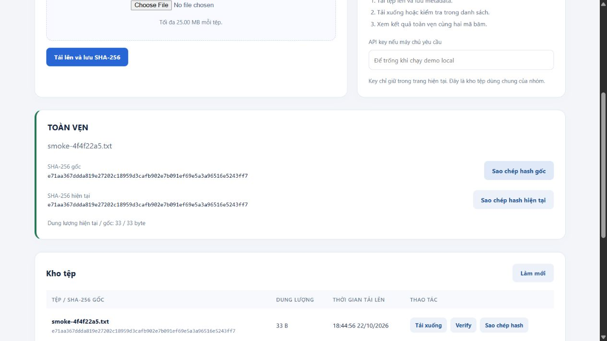
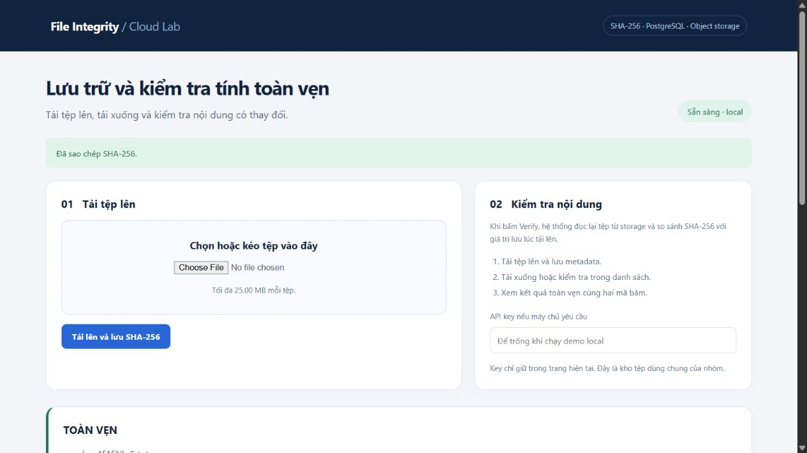

# Kiểm chứng PR giao diện TV3

## Thay đổi

- Thông báo tiếng Việt cho lỗi 401, 404, 413, 5xx, mạng và timeout.
- Timeout bao phủ cả việc đọc response body; không retry upload tự động và nhắc kiểm tra danh sách khi kết quả upload chưa rõ.
- Nút upload/verify/download thể hiện trạng thái đang xử lý và được bật lại khi hoàn tất hoặc lỗi.
- Khung verify tách riêng hash gốc/hiện tại và dung lượng; hỗ trợ sao chép hash, xác nhận thành công và thông báo khi clipboard bị từ chối.

## Kiểm thử

`node --test tests/frontend/api-client.test.cjs`: 13 ca đạt, dùng HTTP server local thật cho success, raw upload, 401/404/413/503, timeout trước header và trong body, JSON lỗi, binary download; có kiểm tra không retry và clipboard thành công/từ chối. Bộ frontend được chạy lại ngày 28/10/2026.

Hồi quy: 17 pytest backend và smoke PostgreSQL/frontend đã đạt trên cùng thay đổi ứng dụng. CI của PR chạy lại toàn bộ bộ kiểm tra trong môi trường sạch.

## Ảnh thực từ browser

Các ảnh dùng tệp smoke giả của bài lab, không chứa API key hoặc dữ liệu người dùng.

Các test HTTP lỗi/timeout là kiểm thử có kiểm soát. Ảnh phía trên là verify và clipboard trên ứng dụng local thật; không phải minh chứng triển khai OpenStack.
